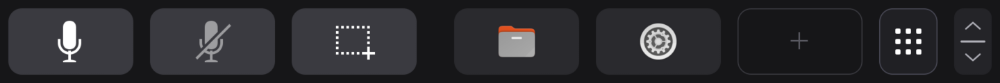

# screenpad

Makes the first-generation ASUS ScreenPad (5.5", 1080x1920) work on Linux on the **ASUS ZenBook UX480FD**, with Ubuntu and GNOME:

- **Display:** lights the ScreenPad and makes it a normal extended monitor, at boot and after resume, with Secure Boot on or off. It runs in userspace only: no kernel module, no `acpi_call`.
- **Touch bar:** turns the top strip of the ScreenPad into a row of touch buttons and app shortcuts, and keeps the rest of the panel a touchpad. Buttons send keys or run commands; shortcuts open apps. Each press plays a soft click, so you know it landed without looking ([the click](docs/touchbar.md#the-bar)). You add shortcuts by dragging app icons onto the bar, and resize the bar with a grip. Other programs can draw button spots and ask you questions in the bar, through a local socket ([app API](docs/app-api.md)). For a question, and for a GNOME notification that has buttons, the bar grows into a card whose buttons answer it or press the notification's own buttons, then shrinks back. GNOME joins the ScreenPad to the main screen as one more monitor; the pointer, windows and the overview are kept off it ([keeping the desktop off](docs/touchbar.md#keeping-the-desktop-off-the-screenpad)). Below the bar the panel is black, with a faint clock and battery level; a tap on the bar's page button (an app grid icon) or a swipe along the bar turns to an apps page, where touches below the bar never move the pointer, and it comes back to the touchpad by itself after 8 s without a touch ([the two pages](docs/touchbar.md#the-two-pages)), where apps give it pages of large widgets. **Fn+F6** cycles the touchpad and the ScreenPad's display: both off, then the touchpad alone (the display dark, the whole panel a plain touchpad), then both on. "Display off" is the ScreenPad's backlight off: the monitor stays connected and driven by the GPU, and GNOME keeps it as a monitor; `sudo screenpad off` disconnects it ([Fn+F6](docs/touchbar.md#fnf6-touchpad-and-display)).
- **Apps:** the agent app, which puts your [Herdr](https://herdr.dev) coding agents and firstmate's Captain's Calls on the touch bar, has its own repository and installer: [screenpad-agents](https://github.com/mmarsot/screenpad-agents).



*The touch bar with its three default items (push to talk, mute microphone, screenshot), two apps added, an empty spot, the page button (an app grid: a tap goes to the apps page) and the resize grip. Rendered by the GNOME Shell extension in a headless GNOME Shell 50.1.*

## Supported hardware and what was tested

Tested on one machine:

| | Tested |
|---|---|
| Laptop | ASUS ZenBook UX480FD (DMI product `ZenBook UX450FDX_UX480FD`), GeForce GTX 1050 Max-Q |
| OS | Ubuntu 26.04 LTS, kernel 7.0, Secure Boot on (kernel lockdown `integrity`) |
| Driver | NVIDIA proprietary driver 580.178.04 |
| Desktop | GNOME Shell 50.1 on Wayland |

**Other laptops are refused.** Both `screenpad` and `install.sh` check the DMI product name, because the connector, the EDID and the WMI power calls were worked out for this one model. Other first-generation ScreenPad laptops, such as the UX580, are similar but untested; supporting one means adding its DMI id and checking those three things on the hardware. The second-generation ScreenPad 2.0 (UX434, UX534 and others) is not covered.

What was checked on the hardware:

- **Display:** the panel lit with `screenpad on`, turned off with `screenpad off`, and lit at boot from the systemd unit. The EDID came from the GlassPad UX580 dump, through `drm.edid_firmware`, with Secure Boot on.
- **Touch bar:** bar touches never move the pointer, and the touchpad works below the bar. A held button sends its key. Drag-and-drop shortcuts, resizing and drawing on the ScreenPad only (with an external monitor also connected) work. Typing and plain-touchpad fallback work after `screenpad-touchbar off` and after a daemon crash.

What was not checked on the hardware:

- **Display:** relighting after suspend and resume; reading the EDID over DDC (it failed with `Input/output error` on the tested unit); the debugfs path used on kernels without lockdown (covered by unit tests only); X11 sessions.
- **Touch bar:** the latest bar changes (keeping windows below the bar, the new grip) and the Alt+K push-to-talk key were checked in a headless GNOME Shell 50.1, not yet on the panel. The same goes for the scene of tiles: in a headless GNOME Shell 50.1 the new extension draws today's bar pixel for pixel as the previous one did, and draws app tiles and questions; touching app tiles and questions on the panel is not yet checked. The elastic bar and notification cards were checked there too, with real notifications (buttons pressed, Do Not Disturb, dismiss, timeouts), not yet on the panel. The two pages (the black screensaver behind windows, the clock, the page button and the apps page over windows) were drawn there by the extension from the daemon's own scenes, and the battery level from a stand-in UPower (discharging, charging, full, no battery), not yet from the laptop's own; the swipe along the bar and the apps page's touch routing are tested without hardware, not yet on the panel, whose sample rate decides how reliable a 25 mm swipe on a 10 mm bar is. Apps' pages on the apps page (the home list, widgets pressed and held), and the config's items there (apps with their own icon and name) and on the bar, were drawn there the same way; taps, long presses and the 0.3 s arming on them are tested without hardware only. The press click was checked there too: the extension calls GNOME's sound player with `click.wav` each time the daemon's count of presses goes up, and not otherwise; it has not yet been heard on the panel's speakers. Keeping the desktop off the ScreenPad was checked there with two virtual monitors in all four placements (the pointer stopped at the shared edge and let off the ScreenPad, windows sent back after a keyboard move, a mouse drag and maximized, the overview's ScreenPad view hidden, all undone when the extension is disabled), not yet on the panel. Fn+F6's cycle is tested without hardware, against a GNOME that flips the touchpad setting on each press as gsd-media-keys does, and its setting reader against a real `gsettings` in an isolated session; not yet with the key on the laptop, nor `screenpad light` and `dark` through the udev rule. Its ScreenPad on indicator was checked in a headless GNOME Shell 50.1 with GNOME's own `ShowOSD` calls and the daemon's scenes, in both orders (GNOME's touchpad-off indicator replaced, every other indicator unchanged, GNOME's restored when the extension is disabled); not yet with a real Fn+F6 press.

## Quick start

Read the [install guide](docs/install.md) first: it explains each step, what to expect, and how to undo it. In short:

```sh
git clone https://github.com/mmarsot/screenpad-linux.git
cd screenpad-linux
sudo ./screenpad.py status
curl -LO https://github.com/kan0p/asus-screenpad-linux/raw/HEAD/edid/ux580-tsb-fixed.bin
sudo ./screenpad.py capture-edid --from ux580-tsb-fixed.bin
sudo ./screenpad.py on
sudo ./install.sh
sudo screenpad grub apply
sudo reboot
```

`sudo screenpad grub apply` adds a kernel boot parameter and is needed only with Secure Boot on. After the reboot, as your user (in group `input`):

```sh
screenpad-touchbar on
```

Then log out and in once.

## Known limitations

- **Secure Boot needs a boot parameter.** With Secure Boot on, the kernel is in lockdown and refuses the debugfs EDID override. The EDID is then loaded through the kernel's `drm.edid_firmware` parameter, which `sudo screenpad grub apply` adds to GRUB and `sudo screenpad grub remove` takes out again. The tool never changes Secure Boot itself. Details: [Secure Boot](docs/display.md#secure-boot-kernel-lockdown).
- **NVIDIA proprietary driver only.** The ScreenPad hangs off the NVIDIA GPU's HDMI output, and only the proprietary driver (with nvidia-drm) was tested. GNOME renders on the Intel GPU and copies each frame to the NVIDIA output, which costs some CPU/GPU time.
- **The EDID comes from another model.** DDC did not answer on the tested unit, so the guide uses the UX580 EDID published by the GlassPad project. It worked on the tested UX480FD; other units may differ.
- **Brightness is fixed.** Any write to the ScreenPad's `brightness` darkens the panel (the firmware's power calls are inverted on this model), so leave the ScreenPad brightness alone.
- **The touch bar needs GNOME Shell 50 on Wayland and a re-login.** The bar is drawn by a GNOME Shell extension that declares GNOME 50 only. GNOME loads a new or updated extension only at login, so log out and in after installing or updating it.
- **The touch bar needs group `input`.** The daemon reads the touchpad directly, so your user must be in group `input`, which can read every input device, keyboards included.
- **Touch bar keys go to the focused window,** like typing. The default Push to talk button sends Alt+K. That is an example set up for [Claude Code's voice dictation](https://code.claude.com/docs/en/voice-dictation) (see [Push to talk](docs/configuration.md#push-to-talk)); set your own app's key in the config.
- **No full-panel touchscreen.** The digitizer only reports itself as a touchpad. The touch bar is drawn and handled in software; a touchscreen mode for the whole panel is not implemented.

## Troubleshooting

| Problem | Where to look |
|---|---|
| `unsupported machine` | Your laptop is not a UX480FD; see [above](#supported-hardware-and-what-was-tested) |
| The panel stays dark | `echo 4 \| sudo tee /sys/class/backlight/asus_screenpad/bl_power` or `sudo screenpad replug` relights it; see [If the panel stays dark](docs/display.md#if-the-panel-stays-dark) |
| `has no EDID after forcing it on` | With Secure Boot on, apply the boot parameter (`sudo screenpad grub apply`, reboot); see [If nvidia-drm does not take it](docs/display.md#if-nvidia-drm-does-not-take-it) |
| The ScreenPad shows sideways or upside down | Rotate it in Settings > Displays; see [GNOME placement](docs/display.md#gnome-placement) |
| No touch bar, or it misbehaves | `screenpad-touchbar status`, then the [touch bar troubleshooting](docs/touchbar.md#troubleshooting) table |
| You want the plain touchpad back now | `screenpad-touchbar off` |

For a bug report, include `screenpad status`, `screenpad-touchbar status`, `journalctl -b -u screenpad` and `journalctl --user -u screenpad-touchbar`.

## Uninstall

```sh
sudo screenpad grub remove
screenpad-touchbar off
sudo ./install.sh uninstall
sudo reboot
```

Run `sudo screenpad grub remove` only if you applied the boot parameter. Run `sudo ./install.sh purge` instead of `uninstall` to also delete the saved EDID. The [install guide](docs/install.md#rollback-and-uninstall) has the details and a manual rollback.

## Documentation

| Document | Contents |
|---|---|
| [Install guide](docs/install.md) | prerequisites, step-by-step install, verifying, updating, uninstalling |
| [Display](docs/display.md) | how the display bring-up works, every `screenpad` command, Secure Boot and `drm.edid_firmware`, GRUB, manual rollback, GNOME placement |
| [Touch bar](docs/touchbar.md) | using the bar, its commands, troubleshooting, how it works |
| [Touch bar configuration](docs/configuration.md) | `~/.config/screenpad/touchbar.toml`, every setting, examples, push to talk |
| [Touch bar app API](docs/app-api.md) | the socket for apps: tiles, questions, `screenpad-touchbar ask` |
| [Development](docs/development.md) | code layout, the checks and the test suite |
| [screenpad-agents](https://github.com/mmarsot/screenpad-agents) | the agent app, an app of the touch bar in its own repository: Herdr's agents and firstmate's Captain's Calls |

## Follow-ups

- **Full-panel touchscreen mode:** taps land on the panel's pixels everywhere. This needs the daemon to re-emit contacts as a direct touchscreen mapped to the ScreenPad output, and a way to switch to it (Fn+F6 already cycles the touchpad and the display).
- **Touch bar extras:** a GNOME Quick Settings toggle for the bar; buttons that show state (for example the microphone's mute state); more than three buttons or shortcuts; files, folders or commands as shortcuts; dragging a shortcut off the bar to remove it.
- **`screenpad brightness N`:** if a brightness level survives the relight (unverified), this command would set it and relight the panel.
- A Quick Settings toggle for the ScreenPad's display (the session can already light and darken it without `sudo`, through `screenpad light` and `dark`).
- Support for other first-generation ScreenPad models, given testers with the hardware.

## Tests

```sh
python3 -m unittest discover -s tests
```

They need no root and no hardware. `make check` also runs the format, lint and type checks that CI runs; see [Development](docs/development.md). Contributors and coding agents start from [AGENTS.md](AGENTS.md).

## Credits and license

A clean-room implementation, written from a hardware feasibility study and from the community [GlassPad](https://github.com/kan0p/asus-screenpad-linux) findings for the UX580. No GlassPad code is used; their GPL-3.0 EDID dump is only downloaded by the user during install. The kernel and nvidia-drm behaviour described in [Display](docs/display.md) was read from the Linux v7.0 source and NVIDIA/open-gpu-kernel-modules tag 580.178.04; no code from either is used.

Released under the [MIT License](LICENSE).
