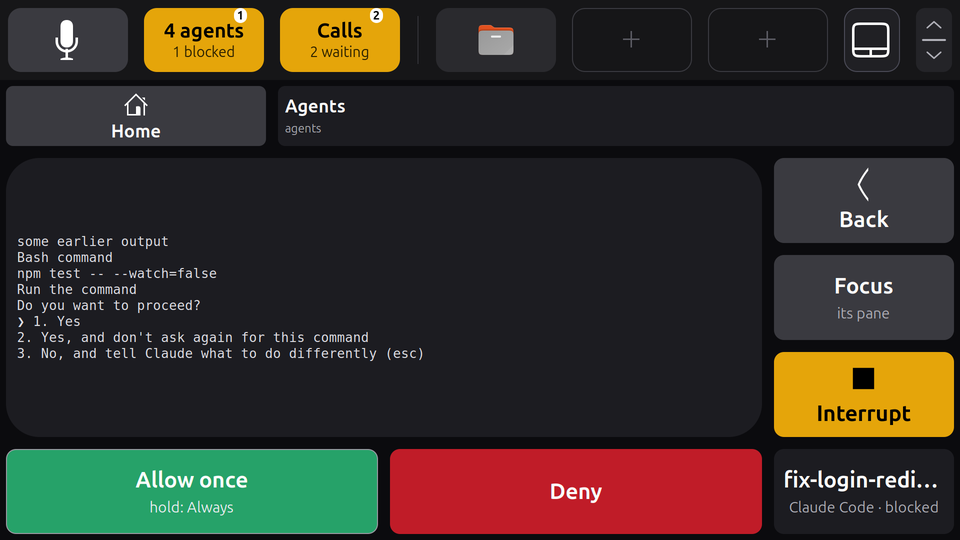

# The agent app

`screenpad-agents` puts your coding agents on the touch bar. It is a separate program, an ordinary [app of the touch bar](app-api.md), with nothing special in the daemon. It shows:

- **every agent [Herdr](https://herdr.dev) reports**, one large widget each on the [apps page](touchbar.md#the-two-pages), colored by Herdr's own state: green while working, amber while blocked (waiting for you), grey when idle or unknown. Herdr is the authority on which agents run and in what state; the app only shows what it says.
- **which firstmate task each agent is**, when you use firstmate: an agent whose pane is a task's recorded endpoint is named after the task, with what the task is doing. Agents outside firstmate still show, named after their directory.
- **how many Captain's Calls are waiting** in firstmate: decisions and contributions that need you. Tapping the count opens [firstmate's decisions board](#captains-call-and-the-decisions-board) in your browser, on the main screen, where you answer them.
- **an agent's card**, when you tap it: the agent's own screen, Focus and Interrupt, and when it waits on a Claude Code permission dialog, the answers: Allow once, Always and Deny.
- two **tiles for the bar**, if you give them spots: `agents` (how many agents, how many blocked) and `calls` (the Captain's Call count).


*The Agents page with four agents, three of them firstmate tasks, and the `agents` and `calls` tiles in the bar. Rendered by the extension in a headless GNOME Shell 50.1, from the app connected to the daemon's own socket server, fed a stand-in Herdr and firstmate reader.*

Tap an agent's widget to open [its card](#an-agents-card). Tap the `agents` tile to focus the first blocked agent's pane in Herdr. Tap Captain's Call (the widget or the `calls` tile) to open firstmate's decisions board on the main screen and read firstmate again at once.

The panel answers no Captain's Call: it takes you to the board, where you answer them.

## Turning it on

`install.sh` installs the app but leaves it off: **it refuses to run until you write its config**, so installing it changes nothing.

1. Write `~/.config/screenpad/agents.toml`:

   ```toml
   [herdr]
   session = "default"          # the Herdr session your agents run in

   [firstmate]                  # leave this table out without firstmate
   home = "/home/you/firstmate" # your firstmate home (FM_HOME)
   code = "/home/you/firstmate" # the firstmate checkout with bin/fm-bearings-snapshot.sh and bin/fm-control.sh
   ```

   The unit runs with your session's `PATH`. If `lavish-axi` or the `node` it needs is not on it (a node from nvm usually is not), name them: `lavish = ["/home/you/.nvm/versions/node/v24.18.0/bin/node", "/home/you/.local/bin/lavish-axi"]` in `[firstmate]`.

2. Check what it would show:

   ```sh
   screenpad-agents show
   ```

   It prints each agent with its pane, kind, state and task, then the Captain's Call count, and exits 1 when Herdr does not answer.

3. Start it, and keep it on at every login:

   ```sh
   systemctl --user enable --now screenpad-agents
   ```

4. Optionally, give its tiles spots in the bar, in `~/.config/screenpad/touchbar.toml` (at most three buttons in all, see [configuration](configuration.md#settings)):

   ```toml
   [[button]]
   icon = "utilities-terminal-symbolic"
   label = "Agents"
   tile = "agents"

   [[button]]
   icon = "dialog-question-symbolic"
   label = "Calls"
   tile = "calls"
   ```

   Without spots the app still gives the apps page its **Agents** page; it logs that the tiles have no spot.

To turn it off: `systemctl --user disable --now screenpad-agents`. Removing the config also keeps the unit from starting (`ConditionPathExists`).

## The config

`~/.config/screenpad/agents.toml` (or `$XDG_CONFIG_HOME/screenpad/agents.toml`; `--config FILE` for another one). It is strict: an unknown table or key, or a bad value, stops the app with a message naming it (exit status 2). The unit does not restart after such an error, so once the config is fixed, start it again: `systemctl --user restart screenpad-agents`.

| Setting | Meaning |
|---|---|
| `[herdr] session` | required: the Herdr session to read. Every Herdr call names it (`--session`), never the session the environment would pick |
| `[herdr] command` | the Herdr program, `"herdr"` by default; or a list of words, for a wrapper and its arguments |
| `[herdr] poll` | seconds between two reads of Herdr's agents, 1 to 60, default 2 |
| `[firstmate] home` | your firstmate home, an absolute path. There is no default: without `[firstmate]` nothing of firstmate is read, and the page has no Captain's Call |
| `[firstmate] code` | the firstmate checkout, an absolute path; it must have an executable `bin/fm-bearings-snapshot.sh` and `bin/fm-control.sh` |
| `[firstmate] poll` | seconds between two reads of firstmate, 60 to 3600, default 60 |
| `[firstmate] lavish` | the program that lists Lavish's sessions, to find the decisions board open: `"lavish-axi"` by default; or a list of words, such as a `node` and the script |
| `[firstmate] opener` | what opens the board's URL in the browser: `["gio", "open"]` by default (the desktop's URL handler); or a program, such as `"xdg-open"` |

## The Agents page

The page is a grid four widgets wide and two to four rows high: Captain's Call first, then one widget per agent in Herdr's order, so a widget stays where it is while its agent runs. When the agents do not all fit in its 16 cells, the last one says how many more there are. The home page's list shows the page with the agent count and the number blocked.

A widget's label is the agent's firstmate task (or its directory), and its text the agent's kind, its state and what the task is doing. The touch bar's own rules keep a tap safe: a widget that changed in the last 0.3 s takes no touch, and one that changes under a finger cancels that touch (see [What a touch does](app-api.md#pages-on-the-apps-page)).

## Captain's Call and the decisions board

firstmate's Captain's Calls are free text, with no list of answers a button could give, so the panel does not answer them: tapping Captain's Call, the widget or the `calls` tile, takes you to where you do, **firstmate's decisions board**, the Lavish board `/bearings lavish` builds. The tap acts when you lift on it, with the touch bar's usual rules (no touch in the 0.3 s after the widget appears or changes, sliding away cancels).

1. It asks firstmate which file the board is: `FM_HOME=<home> <code>/bin/fm-bearings-board.sh path`.
2. It asks Lavish whether that board is open: `lavish-axi`'s session listing (the program, with no argument), the row for that file's real path with status `open` and its session URL.
3. If it is, it opens that URL with the desktop's URL handler (`gio open <url>`), the way Lavish itself opens firstmate's boards: your browser shows the board's session in its window. The app moves no window: the board shows where your browser's window is, which is the main screen unless you moved that window to the ScreenPad (where the apps page would cover it). Only a URL on this machine (`http://127.0.0.1`, `localhost` or `[::1]`) is opened.
4. If no board is open, it opens nothing and builds nothing (firstmate composes the board): a card in the bar says **No decisions board open** and to ask firstmate for `/bearings lavish`, with an OK that only closes it. A command that fails shows **Decisions board not opened** and why on the same card.

A second tap while the board is opening does nothing more. The tap sends nothing to an agent and writes nothing into firstmate; the board answers through firstmate's own intake. `screenpad-agents show` prints the board's URL, or that none is open, without opening it.

## An agent's card



*The card of a blocked agent, opened from the Agents page. Rendered by the extension in a headless GNOME Shell 50.1, from the app connected to the daemon's own socket server, fed a stand-in Herdr and firstmate.*

Tapping an agent opens its card in place of the grid, until you tap **Back**, an answer is sent, or the agent leaves Herdr's list. It shows the last lines of the agent's own screen (Herdr's `pane read`, without the dialog's frame or blank lines, at most 16 lines of 120 characters; a longer dialog shows its end, and **Focus** shows it whole), read again every `poll` seconds while the card is open.

- **Focus** focuses the agent's pane in Herdr.
- **Interrupt** interrupts the agent. For a firstmate task it runs firstmate's control plane, `FM_HOME=<home> <code>/bin/fm-control.sh <task> interrupt`, which knows the task's harness and checks the result; for another agent it sends its harness's interrupt key through Herdr (Escape for Claude Code), after checking that the same kind of agent is still in the pane. For an agent whose harness the app does not know, or while firstmate has not been read yet, Interrupt is dimmed and says why. The card says what firstmate or Herdr answered.
- **Answers**, while Herdr reports the agent blocked on a permission dialog its harness's keymap knows (below): **Allow once** is a tap, **Always** a long press (0.8 s) on the same button, shown as "hold: Always" only when the dialog offers it, and **Deny** a tap.

### Answering safely

The touch bar never takes a touch that starts within 0.3 s of a widget appearing or changing, and cancels a finger on a widget that changes. The card builds on that, and the app checks again right before it types:

- The answer buttons' ids carry a digest of the screen drawn and the agent's `state_change_seq`, so a screen that changed is new buttons: the touch bar arms them again for 0.3 s, a finger already on the old ones chooses nothing, and a tap names the screen it was made on. A tap on buttons the card no longer shows does nothing.
- **Keys are sent only if, at the moment of sending, all three still hold:** Herdr reports the agent still blocked (and the same kind of agent); its `state_change_seq` is the one recorded when the card was drawn; and a fresh `pane read`, taken immediately before `send-keys`, gives the very lines drawn (the same digest).
- On any mismatch nothing is sent: the card is drawn again with the new screen and says "nothing sent" and why, and a fresh tap on the new buttons is needed, after the 0.3 s again. Herdr's pane `revision` is not used: it does not change when a dialog does, and `state_change_seq` changes only with the state, so a dialog swapped for another (`npm test` turned `rm -rf build`, still blocked) is caught only by the text.
- While an answer is on its way its buttons are hidden, so a second tap cannot follow it.

A screen that changes on every read (a clock or a spinner in the dialog's lines) gives new buttons every `poll` seconds; answer such an agent in its pane.

### The keymap

The answers come from a per-harness keymap, keyed by the kind of agent Herdr reports. It starts with Claude Code (`claude`):

| Answer | Keys | Offered when the drawn lines show |
|---|---|---|
| Allow once | `1` | a question line "Do you want to …?", and right under it the option `1. Yes` and nothing more |
| Always | `2` | the next option, `2. Yes, …` ("and don't ask again …", "allow all edits during this session") |
| Deny | Escape | an option `No` under the question |
| Interrupt | Escape | (always, for an agent of that kind) |

The dialog is the last question line on the screen with its options right under it, so a question in earlier text over another dialog's numbered choices (Claude Code's plan approval, "1. Yes, and auto-accept edits") is never answered.

A dialog that matches none of this, or one that must never be answered with a key (Claude Code's folder-trust, external-imports and bypass-permissions dialogs), and every agent of another harness, gets a read-only card: its screen, Focus and Interrupt, and "no dialog this card knows" (or "answer it in its pane" for a harness with no keymap, or when its screen could not be read). A new harness is one entry in `screenpad_agents/keymap.py`.

## How it reads and acts

- **Herdr:** `herdr agent list --session <session>` every `poll` seconds, and while a card is open `herdr agent get <pane>` and `herdr pane read <pane> --source visible --format text`; `herdr agent focus <pane>` on Focus, and `herdr agent send-keys <pane> <keys>` for an answer that passed the checks above or an interrupt; every one with `--session <session>`. They run off the app's loop, so a slow Herdr never delays a touch.
- **firstmate:** its own read-only reader, never its files:

  ```sh
  FM_HOME=<home> <code>/bin/fm-bearings-snapshot.sh --json --fields endpoints
  ```

  It takes about 3 s, and runs at most once a minute plus when you tap Captain's Call. That tap also runs `FM_HOME=<home> <code>/bin/fm-bearings-board.sh path` and `lavish-axi`, and the opener with the board's URL, [above](#captains-call-and-the-decisions-board), in the thread of firstmate's control. Interrupting a task's agent runs `FM_HOME=<home> <code>/bin/fm-control.sh <task> interrupt` in a thread of its own; it is the only firstmate command the app runs that acts on anything (`fm-bearings-board.sh` runs only as `path`; the app never builds or arms a board). The count is the number of open decisions plus the captain's contributions (`decisions_open` and `contributions.captain` in its `fm-bearings.v1` output), shown with a `+` when the reader left some out. Each task's endpoint, `<session>:<pane id>` for Herdr, joins the task to the agent Herdr reports in that pane. The app passes firstmate's commands only `FM_HOME`, and `lavish-axi` and the opener none of `FM_*`, none of the other `FM_*` variables of its own environment.
- **The touch bar:** the socket in `$XDG_RUNTIME_DIR/screenpad/touchbar.sock`, as app `agents` with tiles `agents` and `calls` (only `agents` without firstmate) and page `agents`. It sends a page or tile only when it changed, and connects again every 5 s while the daemon is not running.

## Troubleshooting

| Problem | Where to look |
|---|---|
| `agents.toml does not exist` | Write the config (above); the app runs only once you do |
| The page says **Herdr unavailable** | `screenpad-agents show` prints Herdr's error. Is the Herdr server running, and is `[herdr] session` the session your agents are in (`herdr session list`)? |
| **No agents** | Herdr reports none in that session; `herdr agent list --session <session>` |
| An agent shows without its task | firstmate has no Herdr endpoint for that pane in that session; `screenpad-agents show` lists the join |
| Tapping Captain's Call says **No decisions board open** | firstmate has no Lavish board open: ask it for `/bearings lavish`, then tap again. `screenpad-agents show` says what the app sees |
| It says **Decisions board not opened** | the card says which command failed: `lavish-axi` not found by the unit (set `[firstmate] lavish`, above), the URL handler (`[firstmate] opener`), or a firstmate checkout without `bin/fm-bearings-board.sh` |
| Captain's Call says **firstmate unreadable** or **(stale)** | the reader failed; the app logs why once (`journalctl --user -u screenpad-agents`) |
| A blocked agent's card has no answer buttons | Its harness has no keymap, or its screen is not a permission dialog the keymap knows (the card says "answer it in its pane" for a harness with no keymap or an unreadable screen, "no dialog this card knows" for a screen its keymap does not recognise); answer it there, through **Focus** |
| An answer says **nothing sent** | The dialog or the agent's state changed between the card being drawn and your tap; read the new card and tap again |
| **Interrupt** is dimmed | The agent's harness has no known interrupt key and it is no firstmate task, or firstmate has not been read yet |
| **Interrupt** says failed | firstmate's control plane refused (`fm-control.sh` says why) or Herdr did; the app logs it (`journalctl --user -u screenpad-agents`) |
| The tiles stay dimmed | the app is not running, or another app provides the tiles; `systemctl --user status screenpad-agents` |
