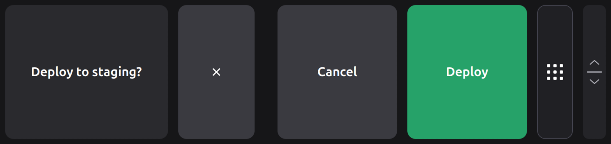
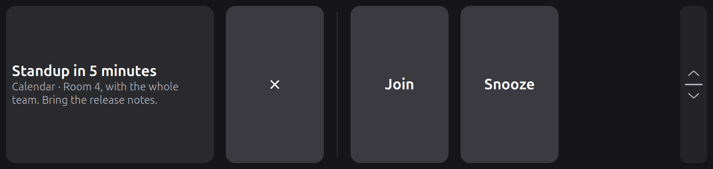
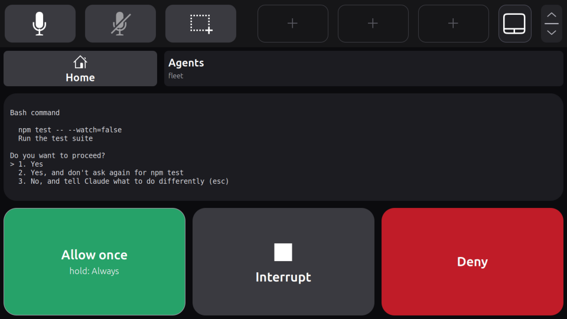

# Touch bar app API

Other programs can use the touch bar (the [agent app](agents.md) is one): an **app** draws and handles button spots the config gives it and [pages of large widgets](#pages-on-the-apps-page) on the apps page, and any program can **ask** the user a question with up to three answers. Both go through a Unix socket that the daemon (`screenpad-touchbar run`) opens next to its state file:

```
$XDG_RUNTIME_DIR/screenpad/touchbar.sock
```

The directory is your user's own and the socket is mode `0600`; the daemon also checks that the connecting process runs as the same user. There is no other authentication: any program you run can use the bar.



*A question, as `screenpad-touchbar ask` below shows it: the bar grows into a card for it. Rendered by the extension in a headless GNOME Shell 50.1.*

## Asking from a shell

```sh
screenpad-touchbar ask "Deploy to staging?" --text "branch agent-bar, 3 new commits" \
    --option no=Cancel --option yes=Deploy --tone no=reject --tone yes=accept --timeout 30
```

It shows the question in the bar until you tap an answer, dismiss it or the timeout passes, then prints the chosen answer's id (`yes` here) and exits 0. Without an answer it prints why on stderr and exits 1: `dismissed`, `timeout`, `unavailable` (the bar cannot show questions right now, see [When questions show](#when-questions-show)) or the daemon not running. A malformed question exits 2.

| Option | Meaning |
|---|---|
| `TITLE` | the question, at most 80 characters |
| `--text TEXT` | a second, smaller line, at most 200 characters |
| `--option ID=LABEL` | an answer, one to three: the id printed when it is chosen (letters, digits, `.`, `_`, `-`, at most 32) and its label (at most 24 characters) |
| `--tone ID=TONE` | an answer's color: `neutral` (grey, the default), `accept` (green), `reject` (red), `warning` (amber) |
| `--timeout SECONDS` | 1 to 3600, default 60 |

## How a question shows and is answered

- **The bar grows into a card** for it: 456 px tall (about 29 mm, which leaves about 39 mm of touchpad below), or the bar's own height if that is taller. The growth is animated. It shrinks back once the question is answered, dismissed or timed out, or goes on to the next question.
- **It grows only when no touchpad finger is in the band it is about to cover**, so it never draws a card under a finger moving the pointer. If one is there, it waits for it to leave, at most 0.3 s, then grows anyway. Either way the touchpad finger stays a touchpad finger to the end of its stroke; only new touches in that band are the card's.
- The card covers the bar's button and shortcut spots: the title and text over the first two button spots, a **Dismiss** cross in the third, and the answers in the three shortcut spots, left to right. The page button stays and still turns the page, and the grip stays and still resizes the bar (its own height, which shows again when the card goes). A card shows the same way on both [pages](touchbar.md#the-two-pages).
- Tap an answer and lift on it (or within 60 px of it, as for tap buttons) to choose it. Sliding away before lifting cancels the tap. A touch on the text does nothing. Dismiss closes the card with no answer (`dismissed`).
- **A touch that starts within 0.3 s of the card appearing does nothing**, counted from when the bar grew, so a tap already on its way to a button, or to where the touchpad was, cannot land on an answer.
- A touch keeps what it started on: a push-to-talk button held when a question appears stays held until you lift, and a finger on an answer when its question goes away (answered elsewhere, timed out) chooses nothing.
- Questions queue, from every app and the [notifications](#notifications) alike: the first shows, the others wait (the text tile shows `+N`). The next one shows in the bar already grown, again ignoring touches for its first 0.3 s. Each one's timeout counts from when it was asked, not from when it shows.

### When questions show

Only while the daemon holds the touchpad (the ScreenPad is on) **and** the bar is on screen, drawn by an extension that knows questions. The extension says so in `renderer.json` next to the socket: `{"protocol": 4, "drawn": true}` while the bar is on screen (questions need protocol 2 or later), `"drawn": false` while it is not (no ScreenPad monitor found, for example). It writes the file while it is enabled and removes it when it is disabled. An extension from before this version, still loaded until you log out and in, does not write it, and could not draw a question. The rule behind all of this: a touch must never answer a question nobody can see. GNOME also disables extensions on the lock screen, so no question shows, or takes an answer, while the screen is locked.

When questions cannot show, a new question is answered `unavailable` at once, and questions already waiting are answered `unavailable` too. Whoever asked can then ask another way, for example in a terminal.

## The protocol

Each side sends one JSON object per line (UTF-8, `\n`-terminated, at most 16 KiB per line). A client that sends a longer line, or does not read its replies (256 KiB pending), is disconnected. At most 16 apps can be connected at once.

### From an app

| Message | Meaning |
|---|---|
| `{"op": "hello", "app": "fleet", "tiles": ["agents"]}` | Say who you are (`app`: lower case letters, digits, `.`, `_`, `-`, at most 32), and which tiles you draw (at most 8 names, same rules). Required first. A tile belongs to the first app that provides it, until that app disconnects |
| `{"op": "set", "tile": "agents", "label": "1 blocked", "tone": "warning", "badge": "2"}` | What one of your tiles shows. Fields: `icon` (an icon name from the theme, or an absolute image path), `label` (at most 32 characters), `text` (a second line, at most 48), `badge` (a short count in the corner, at most 4), `tone` (as for answers). Each `set` replaces the previous one. The extension draws the icon if there is one, otherwise the label and text. A tile you have not `set` yet shows the config's `icon` or `label` |
| `{"op": "ask", "id": "q1", "title": "Run npm test?", "text": "in ~/api", "options": [{"id": "no", "label": "Deny", "tone": "reject"}, {"id": "yes", "label": "Allow once", "tone": "accept"}], "timeout": 45}` | Ask a question. `id` names it in the answer and in `cancel`; it must be unique among your waiting questions. The limits are the `ask` command's |
| `{"op": "cancel", "id": "q1"}` | Withdraw a waiting question; it is answered `cancelled` |
| `{"op": "page", "page": "agents", "title": "Agents", "widgets": [...]}` | Give the apps page a page of widgets, or replace it; see [Pages on the apps page](#pages-on-the-apps-page) |
| `{"op": "unpage", "page": "agents"}` | Take one of your pages away |
| `{"op": "ping"}` | Answered `{"op": "pong"}` |

### To an app

| Message | Meaning |
|---|---|
| `{"op": "welcome", "app": "fleet", "placed": ["agents"], "unplaced": [], "taken": []}` | The answer to `hello`: your tiles that have a spot in the config (`placed`), those that do not (`unplaced`: nothing shows them until the config gives them one), and those another app already provides (`taken`) |
| `{"op": "event", "tile": "agents", "type": "down"}` | A finger went down on your tile |
| `{"op": "event", "tile": "agents", "type": "up", "inside": true}` | It lifted: `inside` is true when it lifted on the tile (or within 60 px of it), which is a tap; false when it slid away, or the touch was cancelled. Hold-style behavior is yours to build from `down` and `up` |
| `{"op": "event", "page": "agents", "widget": "allow", "type": "tap"}` | A touch on a widget of your page: `down`, then one of `tap`, `long` or `cancel`; see [Pages on the apps page](#pages-on-the-apps-page) |
| `{"op": "answer", "id": "q1", "option": "yes", "reason": "chosen"}` | The answer to a question. `option` is `null` when there is none, with `reason` `dismissed` (the user closed the card), `timeout`, `unavailable` or `cancelled` |
| `{"op": "error", "request": "set", "message": "..."}` | A message was refused; `id` is added when the message had one. The connection stays open |

When an app disconnects, its tiles go back to the config's dimmed look, its pages leave the apps page and its waiting questions are dropped unanswered.

## Notifications

The GNOME Shell extension mirrors GNOME's notifications through the same socket, as the app `gnome-notifications`, so a notification is one more source of the card: an app's question and a notification queue together.



*A notification with two buttons, mirrored. Rendered by the extension in a headless GNOME Shell 50.1.*

- For each notification GNOME's message tray asks a banner for, the extension sends `{"op": "notify", "id": "n1", "app": "org.gnome.Calendar.desktop", "source": "Calendar", "title": "...", "text": "...", "urgency": "normal", "actions": ["Join", "Snooze"], "banners": true, "dnd": false, "acknowledged": false}`. `app` is `null` for a notification no app claims, `urgency` one of `low`, `normal`, `high`, `critical`, `banners` whether GNOME shows banners for that app, and `dnd` whether Do Not Disturb is on.
- **The daemon decides** what shows, so the rules are tested with the daemon: a notification GNOME would show a banner for (not low urgency, not already seen, banners on for its app and Do Not Disturb off, except critical ones, which GNOME shows even then), that **has buttons or is urgent** (high or critical), and that the [config](configuration.md#notifications) does not turn off. Anything else is answered at once with `{"op": "answer", "id": "n1", "option": null, "reason": "ignored", "why": "no buttons and not urgent"}`.
- The card's title is the notification's (or its app's name), its text the app's name and the body, and its answers the notification's first three buttons, with ids `action-0` to `action-2`. A card shows for 20 s by default.
- **Tapping one presses the notification's own button.** The extension presses it only if the notification and that very button still exist: if the app replaced its buttons since, nothing is pressed. Dismiss, a timeout and a card that cannot show leave the notification alone, in GNOME's list. Nothing activates a notification by itself.
- An app that updates its notification updates the card (it is armed again, and a finger on the old version chooses nothing). An app or the user that closes the notification takes the card away (`cancel`).
- With no daemon running, the extension mirrors nothing and keeps nothing; it connects whenever the daemon (re)starts.

## Giving an app a spot

A button spot becomes an app's tile with `tile` instead of `key` or `command` (see [configuration](configuration.md#settings)):

```toml
[[button]]
icon = "dialog-information-symbolic"
label = "Agents"
tile = "agents"
```

While no app provides `agents`, the spot shows that icon (or label) dimmed and ignores touches.

## Pages on the apps page

The [apps page](touchbar.md#the-two-pages) is the panel below the bar, swiped to from the bar. It opens on the **home page**, a list of the pages apps give it; tapping one opens it. An app's page has a header with **Home** (back to the list) and the page's title, and under it a grid of large widgets the app lays out. The daemon draws them through the extension, decides what each touch is, and tells the app.



*A page of four widgets in a 3 by 2 grid, as the example below gives it. Rendered by the extension in a headless GNOME Shell 50.1.*

```json
{"op": "page", "page": "agents", "title": "Agents", "text": "1 blocked", "tone": "warning",
 "columns": 3, "rows": 2, "widgets": [
  {"id": "prompt", "col": 0, "row": 0, "cols": 3, "touch": "none",
   "lines": ["Bash command", "  npm test", "Do you want to proceed?"]},
  {"id": "allow", "col": 0, "row": 1, "label": "Allow once", "text": "hold: Always", "tone": "accept", "touch": "long"},
  {"id": "interrupt", "col": 1, "row": 1, "label": "Interrupt", "icon": "media-playback-stop-symbolic"},
  {"id": "deny", "col": 2, "row": 1, "label": "Deny", "tone": "reject"}]}
```

| Page field | Meaning |
|---|---|
| `page` | its name, as for apps (lower case letters, digits, `.`, `_`, `-`, at most 32). A page belongs to the first app that gives it, until that app disconnects or sends `unpage`; each app has at most 4, and the home page holds 8 in all: a new page past that is refused with `the apps page is full (8 pages)`, while replacing one of yours still works |
| `title`, `text`, `icon`, `badge`, `tone` | what the home page's list shows for it (`title` at most 32 characters, else the page's name; `text` at most 48), and `title` in its header |
| `columns`, `rows` | its grid: 1 to 6 columns (default 4) by 1 to 4 rows (default 2) |
| `widgets` | at most 24 widgets; none may overlap |

| Widget field | Meaning |
|---|---|
| `id` | its name in events: letters, digits, `.`, `_`, `-`, at most 32, unique in the page |
| `col`, `row` | its top left cell, from 0 |
| `cols`, `rows` | how many cells it covers, default 1 |
| `label` | a large line, centered (at most 32 characters) |
| `text` | a smaller line under it, which wraps (at most 200) |
| `lines` | up to 16 lines of fixed-width text, each at most 120 characters, drawn as they are (a program's own screen); they shrink to fit the widget. Give such a widget no `icon` or `text` |
| `icon` | an icon name from the theme, or an absolute image path, over the label |
| `badge` | a short count in the corner, at most 4 characters |
| `tone` | its color, as for answers: `neutral`, `accept`, `reject`, `warning` |
| `touch` | `tap` (the default), `long` (a tap, or a long press), or `none` (shown only; touches on it do nothing) |

A widget must show something: a `label`, `text`, `lines` or an `icon`. Each `page` replaces that page's previous version whole; sending the same page again changes nothing on screen.

**What a touch does.**

- The grid fills the panel below the header, which sits under the bar's own height: a taller bar makes the cells shorter. A card growing out of the bar covers the top of the page for as long as it shows; touches there are the card's.
- A finger on a widget sends `down`; lifting on it (or within 60 px of it) sends `tap`. Sliding away and lifting sends `cancel`.
- A `long` widget held for 0.8 s gets a white edge: lifting then sends `long` instead of `tap`. Sliding away still cancels.
- **A touch that starts within 0.3 s of a widget appearing does nothing**: the page opening or the apps page turning to, the widget being new, changed by a `page` or moved (the bar resized), or a card growing over the page or going. A tap already on its way when the page changed lands on nothing.
- **A widget that changes or goes while a finger is on it sends `cancel`**, and that finger chooses nothing, even if the new version has the same id. So a widget's meaning cannot change under a finger: answer only `tap` and `long`, and only for what the page showed then.
- A touch keeps what it started on, as on the bar: one that started on a widget stays that widget's (or nothing) until it lifts, and a page turning to the touchpad under it cancels it.

The pages need the extension of this version (`renderer.json` protocol 4). An older extension, still loaded until you log out and in, shows only that the apps page needs it, and touches there do nothing.

## A minimal app

```python
import json, os, socket

path = os.path.join(os.environ["XDG_RUNTIME_DIR"], "screenpad", "touchbar.sock")
s = socket.socket(socket.AF_UNIX)
s.connect(path)
f = s.makefile("rw")

def send(msg):
    f.write(json.dumps(msg) + "\n")
    f.flush()

send({"op": "hello", "app": "counter", "tiles": ["agents"]})
count = 0
send({"op": "set", "tile": "agents", "label": "0"})
for line in f:
    msg = json.loads(line)
    if msg["op"] == "event" and msg["type"] == "up" and msg.get("inside"):
        count += 1
        send({"op": "set", "tile": "agents", "label": str(count)})
```

## What the extension draws

The daemon publishes the bar as a scene of tiles in `touchbar.json` (`"version": 2`), with `height`, the height drawn (the card's while one shows), and `strut`, the bar's own height, which is the work area windows on the ScreenPad keep clear of: a card covers them for a moment rather than resizing them. The extension animates a growth of `height` over an unchanged `strut`. It draws each tile without knowing what it is, so new kinds of tiles and new apps need no extension update (GNOME loads extension code only at login). The tile fields are documented at the top of `screenpad_touchbar/scene.py`. The version 1 fields (`spots`, `pressed`, `removing`) are still published, so an extension loaded before this version keeps drawing the ordinary bar until the next login. It shows no app tiles and no questions.
