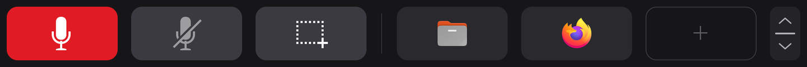

# Touch bar configuration

The touch bar reads `~/.config/screenpad/touchbar.toml`. `screenpad-touchbar on` writes the default there if the file is missing; the file itself has comments explaining every setting.

- **Applying changes:** save the file. The daemon reloads it within a second (or on `systemctl --user reload screenpad-touchbar`). No restart or re-login is needed.
- **Errors:** if the new file has an error, the daemon keeps the current bar and logs why (`journalctl --user -u screenpad-touchbar`). `screenpad-touchbar check` shows the error too, and lists every spot when the file is valid.
- **The bar edits it too:** resizing with the grip writes the `height` line, and adding or removing an app (dragged onto the bar, held to remove, or with `screenpad-touchbar shortcut`) adds or removes that app's block, or moves it. An item of any kind dragged between the bar and the apps page ([moving items](touchbar.md#moving-items-between-the-bar-and-the-apps-page)) has its block moved as it is from `[[bar]]` to `[[apps]]` or back, swapped with the block of the item it replaces. An item added with a `+` ([adding items](touchbar.md#adding-items-with-a-)), or with `screenpad-touchbar shortcut add-key` or `add-command`, gets a block of its own after that list's last one. Every other line and comment is kept, and the bar never otherwise adds, moves or removes an item.

## The default

```toml
height = 160

[[bar]]
icon = "audio-input-microphone-symbolic"
label = "Push to talk"
mode = "hold"
key = "alt+k"

[[bar]]
icon = "microphone-sensitivity-muted-symbolic"
label = "Mute microphone"
mode = "tap"
key = "micmute"

[[bar]]
icon = "applets-screenshooter-symbolic"
label = "Screenshot"
mode = "tap"
key = "printscreen"

# [[bar]]
# app = "org.gnome.Nautilus.desktop"
# [[apps]]
# app = "org.gnome.Settings.desktop"
# [[apps]]
# page = "agents"
```

The file then documents the `[notifications]`, `[screensaver]` and `[pager]` tables, commented out (see [Notifications](#notifications) and [Pages](#pages)).

## Items

The bar and the apps page are both places for **items**, and any kind of item goes in either:

- `[[bar]]` blocks, up to six, fill the bar's six spots left to right; the spots after the last item are empty. The page button and the grip stay at the right end.
- `[[apps]]` blocks, up to eight, fill the apps page's home list (see [The two pages](touchbar.md#the-two-pages)), left to right and top to bottom. The pages that apps give it, and that no `page` item places, follow them. The list has two rows of four, and a third or fourth row when it holds more.

Each item has exactly one of `key`, `command`, `app`, `tile` or `page`, which says what it is:

| Kind | What a touch does |
|---|---|
| `key` | a key or combo, by evdev name with or without `KEY_`, joined by `+`: `"alt+k"`, `"ctrl+alt+t"`, `"super+space"`, `"micmute"`, `"playpause"`, `"printscreen"`, or a raw code such as `"184"`. `meta` and `super` both mean the Super key, not Alt. In `"hold"` mode it is down while the finger is; in `"tap"` mode (the default) it is pressed once when the finger lifts on the item (or within 60 px of it) |
| `command` | a command, as a string for `sh -c` or a list of arguments. In `"tap"` mode it runs when the finger lifts on the item; in `"hold"` mode it runs when the touch starts, and `release_command` (optional) when it ends |
| `app` | an app, by its desktop file id, such as `"org.gnome.Nautilus.desktop"` (`.desktop` optional): a tap opens it, or raises it if it is open, as the dock does. On the bar it is drawn as the app's icon, on the apps page as its icon and name. Apps are what the bar adds by drag and drop, and the only items it removes (hold one for a second) |
| `tile` | the name of a tile an app draws and handles (lower case letters, digits, `.`, `_`, `-`); the app gets the touches. A tile goes in one place only. See the [app API](app-api.md) |
| `page` | the name of one of the pages an app gives the apps page: a tap opens it (from the bar, it turns to the apps page on that page). It shows as the app gives it, in the home list in its own place |

And how it shows:

| Setting | Meaning |
|---|---|
| `icon` | a symbolic icon name from the icon theme (the files under `/usr/share/icons/Adwaita/symbolic`, without `.svg`), or the path of an SVG or PNG (`/…` or `~/…`). Symbolic icons are drawn white. An app shows its own icon, and a tile or page what its app draws, unless set |
| `label` | the item's name, drawn as text when there is no `icon`, and said by screen readers. A key or command needs an `icon` or a `label`. While no app provides a tile or page, it shows its `icon` or `label` (else its name), dimmed, and ignores touches |
| `mode` | for a `key` or a `command` only: `"hold"` or `"tap"` (the default), as above |

The bar sends keys through its own virtual keyboard, so a key goes to whatever window has the keyboard focus, exactly as if it were typed, whether its item is on the bar or on the apps page. Key names are evdev key positions, so on a non-QWERTY layout a letter key gives whatever your layout puts at that position.

The other settings:

| Setting | Meaning |
|---|---|
| `height` | the bar's height in panel pixels (about 16 per mm), 64..540; the grip changes it too |
| `[notifications]` | which GNOME notifications the bar shows as cards; see [Notifications](#notifications) |
| `[screensaver]`, `[pager]` | the touchpad page's black screensaver and clock, and the apps page; see [Pages](#pages) |

## Examples

A play/pause key in the third spot, instead of Screenshot:

```toml
[[bar]]
icon = "media-playback-start-symbolic"
label = "Play/pause"
mode = "tap"
key = "playpause"
```

A terminal, opened by running a command:

```toml
[[bar]]
icon = "utilities-terminal-symbolic"
label = "Terminal"
mode = "tap"
command = ["ptyxis", "--new-window"]
```

A spot for an app's tile (here one that calls its tile `agents`; see the [app API](app-api.md)):

```toml
[[bar]]
icon = "dialog-information-symbolic"
label = "Agents"
tile = "agents"
```

A push-to-talk item that unmutes the microphone only while held, for apps without a push-to-talk key:

```toml
[[bar]]
icon = "audio-input-microphone-symbolic"
label = "Talk"
mode = "hold"
command = "pactl set-source-mute @DEFAULT_SOURCE@ 0"
release_command = "pactl set-source-mute @DEFAULT_SOURCE@ 1"
```

Apps on the apps page, a key next to them, and an app's page first in the list:

```toml
[[apps]]
page = "agents"

[[apps]]
app = "bitwarden.desktop"

[[apps]]
app = "org.gnome.Settings.desktop"

[[apps]]
icon = "applets-screenshooter-symbolic"
label = "Screenshot"
key = "printscreen"
```

From a terminal, `screenpad-touchbar shortcut add org.gnome.Settings --apps` adds an app to the apps page (`--spot N` at a place, `remove N --apps` takes one away, `list --apps` shows them); without `--apps` the same commands act on the bar. `screenpad-touchbar shortcut add-key Terminal ctrl+alt+t` adds a key (by name, or by key codes such as `29+56+20`, which it writes by name), and `shortcut add-command Hello "notify-send hello"` a command, in the first free spot (`--apps` on the apps page); items added so are tap items with no icon. Number keys are written by code (`ctrl+2` is Ctrl+1), as a bare digit is a key code.

## Notifications

GNOME notifications that have buttons (a calendar's Join and Snooze, a chat's Reply), and urgent ones, show in the bar: it grows into a card with the notification's title, text and first three buttons, and shrinks back when you tap one, dismiss the card, or after 20 s. Tapping a button presses the notification's own button. Dismissing, or letting the card time out, only closes the card: the notification stays in GNOME's list. A touch in the card's first 0.3 s does nothing, and the bar grows only when no touchpad finger is where the card will be (see the [app API](app-api.md#how-a-question-shows-and-is-answered)).

Nothing shows while **Do Not Disturb** is on, except critical notifications (a battery about to run out), which GNOME itself shows then too. Notifications GNOME would not show a banner for (low urgency, or banners turned off for that app in Settings) never show in the bar either.

To change it, add a `[notifications]` table (after the items):

```toml
[notifications]
mirror = false
```

| Setting | Meaning |
|---|---|
| `mirror` | `false`: no notification shows in the bar. Default `true` |
| `deny` | a list of desktop file ids whose notifications never show, such as `["org.gnome.Evolution.desktop"]` |
| `allow` | a list of desktop file ids: only their notifications show. Notifications that no app claims (from `notify-send`, for example) then never show |
| `timeout` | how long a card shows, in seconds, 1 to 3600. Default 20 |

`screenpad-touchbar check` prints what applies. Questions from apps (`screenpad-touchbar ask`) are not notifications; these settings do not change them.

## Pages

The bar has two pages: the touchpad page, with a black screensaver below the bar, and the apps page, where touches below the bar go to apps: one finger still moves the pointer there, and a still tap or press acts on what is under it. A tap on the bar's page button, which shows the page it goes to (an app grid or a touchpad), or a swipe along the bar turns the page, and the apps page goes back to the touchpad by itself; see [The two pages](touchbar.md#the-two-pages). The black and the pages are always on; two tables change the clock, the wait and what makes a tap on the apps page (after the items):

```toml
[screensaver]
clock = false

[pager]
return_after = 15
tap_time = 0.5
tap_move = 3
```

| Setting | Meaning |
|---|---|
| `[screensaver]` `clock` | `false`: no clock on the black (the battery level stays). Default `true` |
| `[pager]` `return_after` | how many seconds without a touch on the panel the apps page waits before going back to the touchpad, 1 to 3600. Default 8 |
| `[pager]` `tap_time` | on the apps page, the longest tap, in seconds, 0.1 to 2: a touch lifted sooner, without moving, taps what is under it; one held still that long on a widget or an item presses it (to hold a key, long-press a widget or drag an item to the bar). Default 0.4 ([touches on the apps page](touchbar.md#touches-on-the-apps-page)) |
| `[pager]` `tap_move` | on the apps page, how far, in millimetres, 0.5 to 10, a touch may move before it is the pointer's: within `tap_time`, a touch that moves farther moves the pointer and presses nothing. Default 2.5 |

`screenpad-touchbar check` prints what applies (`pages:`).

## Push to talk



The default Push to talk item holds Alt+K down for as long as your finger is on it. Set your voice app's push-to-talk key to Alt+K, or set `key` to the key the app already uses, for example `key = "ctrl+alt+p"`. Apps that read the keyboard only while focused, or only through X11 on a Wayland session, may not see a global push-to-talk key; that is the app's limit.

### Example: Claude Code voice dictation

The default was chosen to work with [Claude Code's voice dictation](https://code.claude.com/docs/en/voice-dictation) in hold mode, in a terminal. Bind the key in `~/.claude/keybindings.json`, where Claude Code calls Alt `meta`:

```json
{
  "bindings": [
    { "context": "Chat", "bindings": { "meta+k": "voice:pushToTalk" } }
  ]
}
```

Then restart Claude Code and run `/voice hold`; it says to hold `meta+k`. Click into the terminal so it has the keyboard focus, then hold the item while you speak.

- Claude Code has one push-to-talk key, so this replaces holding Space. Space still types a space.
- A modifier combo starts recording on the first press, with no warmup. Recording stops shortly after you lift, when the terminal's key repeat stops.
- A terminal multiplexer in between (tmux, for example) passes Alt+K on, as long as it binds nothing to it itself; tmux does not by default.

**Why not F14, or another key no keyboard has?** GNOME maps F13 to F24 to `XF86Tools`, `XF86Launch5` and similar, or to nothing. VTE terminals such as Ptyxis and GNOME Terminal send nothing for those keys, so a terminal app never sees them, and Claude Code names only F1 to F12 anyway. Alt+K reaches the terminal as `ESC k` and repeats while held, and neither GNOME nor Ptyxis binds it.

## Configs from earlier versions

Before items, the bar had three `[[button]]` spots (a key, a command or a `tile`) and then three `[[shortcut]]` spots (apps, by `app`). Those blocks are now `[[bar]]` items, in that order: buttons first, then shortcuts, with no empty spot between them (a bar with fewer than three buttons has its first shortcut in the spot after the last button, not in the fourth). The first version also placed buttons with `x` and `width`, which the spots replaced.

When the daemon, `screenpad-touchbar on` or `screenpad-touchbar shortcut` starts:

- A config that is still exactly an earlier version's default is replaced by the current default.
- In any other config, the earlier default blocks it still has, word for word, are updated: the earlier default Push to talk block (its comment and `key = "F14"`) to `alt+k`; the settings comment gains the lines about `tile`; the comments describing the bar and the pages gain the page button (replacing the page dots of the version before); and the comments describing buttons and shortcuts become the ones about items.
- Then its `[[button]]` and `[[shortcut]]` blocks become `[[bar]]` blocks, each one's lines and comments kept, and `x` and `width` lines dropped. Shortcuts written before a button are moved after the last button. The file is rewritten only when it then parses to the same bar; otherwise it is left as it is and the daemon says what to change (`journalctl --user -u screenpad-touchbar`): rename each `[[button]]` and then each `[[shortcut]]` to `[[bar]]`.

The rest of the file is yours and is left as it is. For example, a bar of Push to talk, two apps' tiles and two shortcuts:

```toml
[[button]]
icon = "audio-input-microphone-symbolic"
label = "Push to talk"
mode = "hold"
key = "alt+k"

[[button]]
icon = "utilities-terminal-symbolic"
label = "Agents"
tile = "agents"

[[button]]
icon = "dialog-question-symbolic"
label = "Calls"
tile = "calls"

[[shortcut]]
app = "bitwarden.desktop"

[[shortcut]]
app = "org.gnome.Settings.desktop"
```

becomes the same five `[[bar]]` items, in the same order. To have the two apps on the apps page instead, rename their blocks `[[apps]]`.
