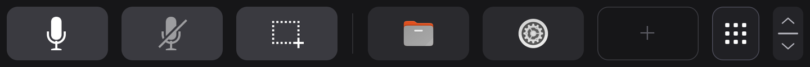
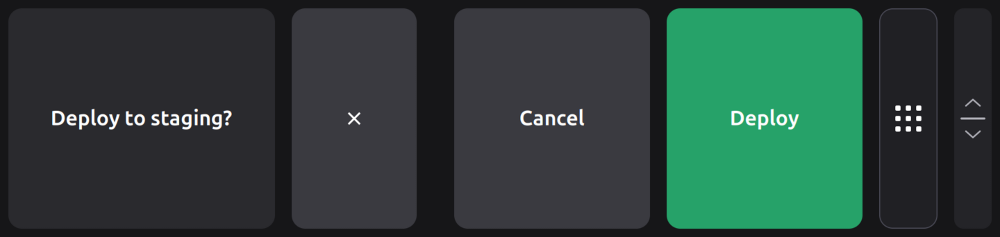
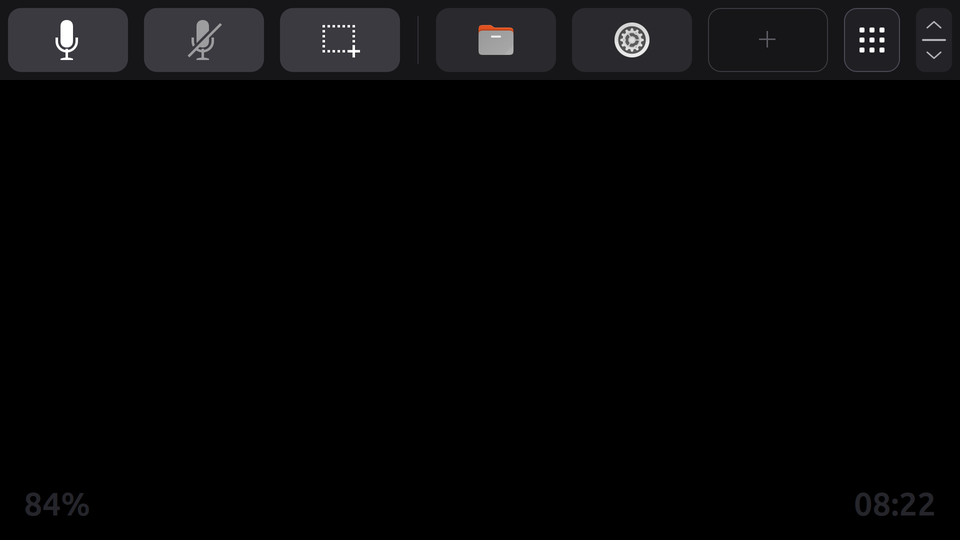
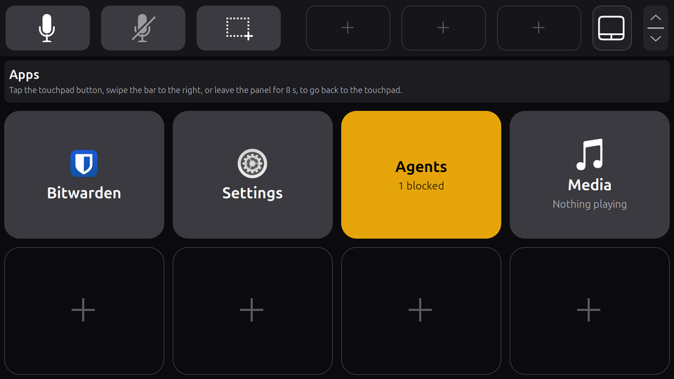

# Touch bar



*The default bar with two shortcuts added, rendered by the extension in a headless GNOME Shell 50.1. Below the bar the ScreenPad is black behind its windows, with a faint clock (see [The two pages](#the-two-pages)).*

The ScreenPad's digitizer (`GDX1505:00 27C6:01F1`) only has a touchpad HID collection, so the whole panel is a touchpad. `screenpad-touchbar` splits it. Installing is in the [install guide](install.md#6-turn-on-the-touch-bar); settings are in [configuration.md](configuration.md).

- **The bar**, a strip along the top edge (the edge nearest the screen hinge), 160 px of the panel's 1080 rows by default (10 mm). A touch that *starts* in the bar belongs to the bar for its whole life, even if the finger slides down into the touchpad area: it never moves the pointer and never clicks. It acts on the spot under it (see [The bar](#the-bar)). While a card shows, the bar is taller: a touch that starts in the band the card added is the card's, while touches already down when the bar grew or shrank keep what they started as.
- **The rest** stays a touchpad: pointer motion, tap-to-click, two-finger scroll and everything else follow GNOME's touchpad settings. A touch that starts below the bar stays a touchpad touch even if it slides up into the bar, so no touch ever appears or vanishes mid-stroke and the pointer does not jump at the boundary. A bar finger does not count as a finger for touchpad gestures either. That is the **touchpad page**, the default; on the **apps page**, below the bar is a surface for apps instead, and no touch there reaches the pointer (see [The two pages](#the-two-pages)).

## The bar

Left to right, each spot 272 px (17 mm) wide:

| Spots | What a touch does |
|---|---|
| **3 buttons** | Push to talk (microphone icon, held: Alt+K down while you hold it; see [Push to talk](configuration.md#push-to-talk)), mute microphone (the mic mute key) and screenshot (Print Screen), by default. Each spot's icon, key or command and hold/tap mode are set in the [config](configuration.md). A hold button turns red while held, a tap button lighter grey. A spot can also be given to an app (`tile` in the config): the app then draws it and gets its touches (see the [app API](app-api.md)) |
| **3 shortcuts** | Apps. Tap one to open the app, or to raise it if it is already open, as the dock does. Hold one for about a second: it turns red with a delete icon, and lifting the finger then removes it. Slide away before lifting to cancel either. An empty spot shows a faint `+` |
| **page dots** | Two dots, the page shown big and white, its name under them. A tap turns to the other page; see [The two pages](#the-two-pages). 144 px (9 mm) wide. Not drawn while the extension loaded is older than the pages |
| **grip** (right end) | The tile with an up arrow, a bar and a down arrow. Drag it down or up to make the bar taller or shorter, in 8 px steps between 64 and 540 px. The bar follows the finger, and the new height is saved when you lift. It is drawn at every height |

**Adding a shortcut.** Drag an app icon from the dock or from the app grid (Super, then Show Apps) onto the bar on the ScreenPad, with the pointer. The target spot lights up blue. Drop it on a shortcut spot to put it there (on a full bar, it replaces that one); drop it anywhere else on the bar to take the first free spot. An app already on the bar moves. It works for anything GNOME shows as an app icon. Files dragged from the file manager are not apps and are not taken. The same is possible from a terminal: `screenpad-touchbar shortcut list`, `screenpad-touchbar shortcut add org.gnome.Nautilus [--spot 2]` and `screenpad-touchbar shortcut remove 2`.

**Cards: questions and notifications.** A program can ask you a question with up to three answers, for example `screenpad-touchbar ask "Deploy to staging?" --option no=Cancel --option yes=Deploy`. GNOME notifications that have buttons, or are urgent, show the same way, with the notification's own buttons. The bar grows into a card for it, about 29 mm tall, covering the button and shortcut spots, with a Dismiss cross; the page dots and the grip stay. It shrinks back when you tap an answer, dismiss it, or it times out. The touchpad below stays a touchpad, about 39 mm tall while the card shows. A touch that starts within 0.3 s of the card appearing does nothing, so a tap already on its way lands on nothing, and the bar does not grow under a finger moving the pointer. See the [app API](app-api.md) and, for which notifications show, [configuration](configuration.md#notifications).



## The two pages

The panel has two pages, and the page dots in the bar always show which one is up.

- **The touchpad page** (home, the default). The bar, and below it the touchpad, exactly as above. Below the bar the extension draws black behind your windows on the ScreenPad's monitor, with a faint clock in the bottom right corner. It is drawn black: the panel's brightness is fixed, so this saves no backlight power, but a still, black picture is redrawn only once a minute. Windows you put on the ScreenPad stay above it. `[screensaver]` in the [config](configuration.md#pages) turns the clock off.
- **The apps page.** Below the bar, a surface for apps, drawn over the ScreenPad's windows. Every touch that starts there belongs to the surface and never reaches the pointer, the clicks or GNOME's gestures. It opens on the home page, a list of the pages apps give it ("No apps here yet" until one does); tap one to open it, and **Home** in its header to come back. An app's page is a grid of large widgets: a tap is a lift on the widget, a long press (0.8 s, on widgets that take one) gets a white edge before you lift, and sliding away cancels. A touch that starts within 0.3 s of a widget appearing or changing does nothing, so a tap already on its way when the page changed lands on nothing. The page shown stays chosen while you are on the touchpad. Apps give their pages through the [app API](app-api.md#pages-on-the-apps-page); the [agent app](agents.md) is one. The bar, its buttons, the dots and cards work the same on both pages.

 

**Turning the page.**

- **Swipe along the bar** with one finger: start on the bar, move at least 25 mm (400 px) across, mostly sideways (rising or falling at most half as much), and lift within 0.4 s. Moving the finger left shows the apps page; moving it right brings the touchpad back. A swipe in the direction with no page does nothing. A swipe with two fingers on the bar does nothing.
- **Tap the page dots**: the other page.
- **Leave it**: the apps page goes back to the touchpad after 8 s without a touch on the panel (`return_after` in `[pager]`). A finger resting on the panel holds it; the 8 s count from the last lift. It also goes back at once when it can no longer be shown (the ScreenPad turned off, the extension gone).

A swipe must start on the bar: a sideways stroke below the bar on the touchpad page is a pointer move, as always, and swipes with three or more fingers stay GNOME's (workspaces). Bar contacts never reach the pointer, so a bar swipe cannot move it or start a GNOME gesture. A swipe that starts on a spot does nothing there: the spot acts as if the finger slid away, and a grip moved by it is not saved. A push-to-talk button held at the start of a swipe is still pressed for the swipe's length, since its key goes down at the touch.

**Touches keep their kind.** Turning the page changes only what new touches are: a touchpad finger already down stays a touchpad finger until it lifts, and a finger already on the apps surface stays the surface's after the page turns back, until it lifts.

Resizing and shortcuts write to `~/.config/screenpad/touchbar.toml`. The daemon edits only the `height` line and the `[[shortcut]]` blocks, keeps every other line and comment, and replaces the file only if the result parses to the same config apart from that change. If it cannot, it logs why and leaves the file alone.

## Commands

After `sudo ./install.sh` (which installs the udev rule for `/dev/uinput`), and with your user in group `input` (see the [install guide](install.md#prerequisites)), as your user:

```sh
screenpad-touchbar on
```

It writes the default config to `~/.config/screenpad/touchbar.toml` if there is none, enables the GNOME Shell extension, and enables and starts the user unit. A newly installed extension loads only at the next login, so log out and in once. Then:

| Command | What it does |
|---|---|
| `screenpad-touchbar on` | as above |
| `screenpad-touchbar off` | stops and disables the user unit; the plain touchpad comes back at once |
| `screenpad-touchbar status` | config, touchpad node, ScreenPad on/off, `/dev/uinput` access, unit and daemon state, the page shown |
| `screenpad-touchbar check` | validates the config and lists every spot |
| `screenpad-touchbar shortcut list\|add APP [--spot N]\|remove N` | the shortcuts, from a terminal |
| `screenpad-touchbar probe` | prints where touches land (panel pixels, bar or pad, which spot) without grabbing; stop the daemon first (`screenpad-touchbar off`), whose grab keeps every other reader from seeing touches |
| `screenpad-touchbar ask TITLE --option ID=LABEL ...` | asks a question in the bar and prints the chosen answer's id; see the [app API](app-api.md#asking-from-a-shell) |
| `screenpad-touchbar run` | the daemon itself, in the foreground (what the unit runs) |

The unit is `screenpad-touchbar.service` (`systemctl --user status screenpad-touchbar`, `journalctl --user -u screenpad-touchbar`). It is part of the graphical session, restarts on failure, and is capped at 64 MB.

## Troubleshooting

Start with `screenpad-touchbar status`. It shows the config, the touchpad node, whether the ScreenPad is on, `/dev/uinput` access, and the unit and daemon state.

| Symptom | Cause and fix |
|---|---|
| No bar at all, touchpad normal | The bar runs only while the ScreenPad is on (`screenpad: off` in `status`): `sudo screenpad on`. Otherwise check `unit:` and `daemon:` in `status`, and `journalctl --user -u screenpad-touchbar` |
| `touchpad: … not readable` | Your user is not in group `input`: `sudo usermod -aG input $USER`, then log out and in |
| `uinput: not writable` | The udev rule is missing or you are not the user at the seat: re-run `sudo ./install.sh`, then log out and in |
| Bar drawn but the extension is missing after install | GNOME loads new extension code only at login: log out and in once. `gnome-extensions info screenpad-touchbar@screenpad` should say `State: ACTIVE` |
| Only bare labels (no dark strip, no pressed highlight) | The extension failed and GNOME unloaded its stylesheet: `gnome-extensions info screenpad-touchbar@screenpad` says `State: ERROR`, and `journalctl -b /usr/bin/gnome-shell \| grep screenpad-touchbar` shows why |
| The bar is drawn on the wrong edge, or touches land in the wrong spot | Check the ScreenPad's rotation ([GNOME placement](display.md#gnome-placement)), then run `screenpad-touchbar probe` and touch the corners: it prints where each touch lands |
| A button's key does nothing | Keys go to the focused window, like typing. Check that the app accepts that key; see [Push to talk](configuration.md#push-to-talk) |
| Config change has no effect | `screenpad-touchbar check` shows the error; the daemon keeps the last good bar |
| No notification shows in the bar | Only notifications with buttons, or urgent ones, show, and none while Do Not Disturb is on (except critical ones). `screenpad-touchbar check` shows the `[notifications]` settings. The extension that mirrors them loads at login: after an update, log out and in once |
| No page dots on the bar | The pages need the extension of this version, which GNOME loads at login: after an update, log out and in once |
| The pointer stopped moving below the bar | The apps page is up (the right dot is big; the apps page says so): swipe the bar to the right, tap the dots, or wait 8 s. `screenpad-touchbar status` shows the page. To shorten the wait, set `[pager] return_after` |
| The apps page says apps need the new extension, and touches there do nothing | The extension GNOME loaded at login is from before apps' pages: log out and in once |
| `ask` always says `no answer: unavailable` | Questions show only while the ScreenPad is on and the extension that knows them runs: after an update, log out and in once (the extension writes `$XDG_RUNTIME_DIR/screenpad/renderer.json`, with `"drawn": true` while the bar is on screen). They never show on the lock screen |
| An app's spot stays dimmed | No app provides that tile: `screenpad-touchbar status` lists the connected apps; check the app's `welcome` reply for its tile under `placed` |

To get the plain touchpad back at once: `screenpad-touchbar off`. If the daemon crashes or is killed, the kernel releases the touchpad by itself.

## How it works

A user daemon grabs the GDX1505 touchpad's evdev node (`EVIOCGRAB`), so libinput no longer reads it. It creates two uinput devices: `ScreenPad Touchpad`, a clone of the real pad (same multitouch axes, ranges, resolution, `BUTTONPAD`/`POINTER` properties, bus and ids), which gets every contact that starts outside the bar, and `ScreenPad Touch Bar Keys`, which sends the buttons' keys. libinput treats the clone as a touchpad, so GNOME's touchpad settings apply to it; because it keeps the real pad's I2C bus id, libinput should also count it as internal for disable-while-typing (unverified). Bar contacts are handled by the daemon itself. A physical click (the pad is a clickpad) reaches the desktop only while a touchpad finger is down. Palms the firmware flags (`MT_TOOL_PALM`) never press a button.

The daemon grabs only while the ScreenPad is on: `screenpad on` creates `/run/screenpad/active` and `screenpad off` removes it, and within a second the daemon lets go, so after `screenpad off` the panel is a plain touchpad again. It grabs only when no finger is down, and before letting go it ends every touch on the clone and waits up to 2 s for fingers to lift, so the desktop never keeps a touch whose end it will not see. If the daemon stops or dies, the kernel drops the grab and destroys both uinput devices, and the plain touchpad works again at once.

The visual is a GNOME Shell extension, since GNOME has no layer-shell protocol for a client to put a panel on one output. The daemon publishes the bar as a **scene of tiles** in `$XDG_RUNTIME_DIR/screenpad/touchbar.json` (`"version": 2`): the bar's height (live while the grip moves, and taller while a card shows) and, for each tile, its rectangle in the bar and what to draw there (an icon, an app's icon, text, the grip), its CSS classes and whether a finger is on it. The extension draws the tiles without knowing what they are, along the top of the ScreenPad's monitor, and draws nothing while the daemon does not hold the pad. So the daemon decides everything the bar shows: today's buttons, shortcuts and grip are the first tiles, apps' tiles and questions are more, and none of them needs an extension update. The daemon still publishes the earlier fields (`spots`, `pressed`, `removing`), so an extension from before tiles, which GNOME keeps until the next login, still draws the ordinary bar.

**The pages** are in the scene too: `page` (`"touchpad"` or `"apps"`), `screensaver` (`{"clock": true}`, or `{"clock": false}` without the clock) and `surface`, what the apps page shows (`null` on the touchpad page). For an extension that draws widgets (renderer protocol 4) it is a `title`, the open `page` and its `widgets`, each a rectangle in panel pixels with what to draw, its classes and whether a finger is on it, drawn like the bar's tiles without knowing what they are; for an extension from before widgets it is instead only a `title`, `text` and `hint`. The extension draws the screensaver behind windows, just above the desktop background, and the apps surface over windows and under the bar, both only on the ScreenPad's monitor and only while it draws the bar. The daemon routes every new contact by where it starts and the page at that moment (`Daemon._zone()` in `screenpad_touchbar/daemon.py`): the bar's above the bar's height, else the touchpad's on the touchpad page and the surface's on the apps page; a contact then keeps that kind until it lifts. Surface contacts never go to the virtual touchpad. The swipe and the return after a while are `screenpad_touchbar/pager.py`; what the apps page shows and what a touch on it does, `screenpad_touchbar/surface.py`.

**Apps** reach the daemon through a Unix socket next to the scene, `touchbar.sock` (your user only; see the [app API](app-api.md)). The daemon keeps the hit-testing: a touch on an app's tile is sent to that app as `down` and `up`, one on a widget of its page as `down` then `tap`, `long` or `cancel`, and a touch on a shown question's answer chooses it. A question shows only while the extension says the bar is on screen and it can draw questions: it writes `renderer.json` next to the scene (`{"protocol": 4, "drawn": true}`) while it is enabled and removes it when it is disabled (on the lock screen, at logout, or when it is turned off). Questions need protocol 2 or later, the pages 3 and apps' widgets 4: until an extension of this version is loaded, the bar has no page dots and stays on the touchpad page (protocol 2), or the apps page only says it needs the new extension (protocol 3).

The extension also does the things only the shell can do:

- **Work area.** The bar's own height is a strut (`addChrome` with `affectsStruts`), so GNOME takes it off the ScreenPad monitor's work area: windows opened or maximized there go below the bar, and their title bars are never under it. The strut follows the bar's height as it changes and goes away with the bar. A card's extra height is not in it: a card covers the top of those windows for a moment instead of resizing them. It lies inside the ScreenPad's monitor, so the laptop screen's and any external monitor's work areas do not change. (Mutter stretches a top strut to the top of the screen only when no monitor sits above it; with the ScreenPad placed below the laptop screen, one does.)

- **Drop target.** The bar is a GNOME Shell drag-and-drop target for app icons. On a drop it runs `screenpad-touchbar shortcut add`, which edits the config and sends the daemon `SIGHUP` so the bar updates at once.
- **Notifications.** It follows GNOME's message tray and forwards each notification GNOME wants a banner for to the daemon, which decides whether it becomes a card. When you tap a card's button, the extension presses that notification's button, if the notification still has it.
- **Opening apps.** On a shortcut tap the daemon calls the extension's D-Bus method `org.screenpad.Touchbar.Launch` (on `org.gnome.Shell`, path `/org/screenpad/Touchbar`). The extension opens or raises the app the way the dock does, and only if the bar shows it as a tile. If the extension is not there, the daemon falls back to `gtk-launch`.

**Which monitor.** The extension finds the ScreenPad by its EDID identity, never by connector name, monitor index, position or resolution, so an external monitor never gets the bar. The daemon reads the vendor, product name and serial from the EDID `screenpad on` hands the kernel (`/var/lib/screenpad/edid.bin`; on the tested unit mutter shows them as `TSB`, `no-audio-HD`, `0x88888800`) and publishes them. The extension draws only if exactly one active monitor matches all three. The touch input is found the same way: the evdev node whose vendor/product is `27c6:01f1` and whose name ends in ` Touchpad`, on a real (not virtual) device.

**Orientation.** The digitizer reports 3840 × 2160 units at 32 units/mm, the panel's 1920 × 1080 pixels at exactly 2 units per pixel, with no axis swapped. The pad works as a touchpad in the right directions, so the digitizer's y = 0 edge is the hinge edge. Bar coordinates are panel pixels as you see the panel with the laptop open: (0, 0) at the top left. The extension draws at the top of the ScreenPad's logical monitor, which is the hinge edge once the monitor is rotated to read upright (see [GNOME placement](display.md#gnome-placement); on the tested unit mutter has it at 270°). `screenpad-touchbar probe` prints where each touch lands, to check that the drawn bar and the touch zones agree.

